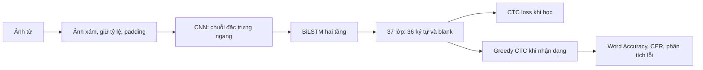

# CRNN nhận dạng từ trên IIIT5K

Đề tài: **Tìm hiểu kiến trúc CNN–BiLSTM–CTC, ứng dụng CRNN nhận dạng từ trong ảnh và phân tích lỗi theo độ dài, độ mờ, biến dạng chữ.**

Đây là dự án PyTorch chạy trên Windows và GPU NVIDIA. Đầu vào là **ảnh đã cắt chứa một từ**. IIIT5K có 2.000 ảnh train và 3.000 ảnh test, gồm chữ trong cảnh và ảnh born-digital; xem [bài giới thiệu dữ liệu BMVC 2012](https://www.bmva-archive.org.uk/bmvc/2012/BMVC/paper127/paper127.pdf).

## Chạy nhanh trên máy hiện tại

Môi trường, dữ liệu và checkpoint đã có sẵn. Mở Terminal PowerShell trong VS Code:

```powershell
Set-Location C:\HOCSAU
.\.venv\Scripts\python.exe -m crnn.predict --checkpoint runs/improved_seed42/best.pt --image data/raw/IIIT5K/test/1002_1.png --device cuda
```

Ảnh mẫu được nhận dạng thành `private`. Mô hình chính đạt Accuracy test **62,10%**; trung bình ba seed cải tiến **61,06%**, baseline **23,53%**. Xem [hướng dẫn từng bước](docs/huong_dan_chay.md), [báo cáo đề tài](docs/bao_cao.md) và [kết quả so sánh](runs/comparison/comparison.md).

## Tài liệu bắt đầu

- [Đề cương và mục tiêu](docs/de_cuong.md).
- [Cách kiểm tra môi trường, nhận dạng, train và đánh giá](docs/huong_dan_chay.md).
- [Kiểm tra code và dọn tệp ngày 11/10/2026](docs/kiem_tra_code.md).
- [Giải thích CNN, BiLSTM và CTC](docs/co_so_ly_thuyet.md).
- [Giao thức thực nghiệm và phân tích lỗi](docs/thiet_ke_thuc_nghiem.md).
- [Mẫu báo cáo để điền kết quả thật](docs/mau_bao_cao.md).
- [Kết quả baseline đã chạy](docs/ket_qua_baseline.md).
- [Kế hoạch thí nghiệm bổ sung đã cố định](docs/ke_hoach_hoan_thien.md).
- [Hướng dẫn gán nhãn biến dạng](docs/gan_nhan.md).
- [Gán nhãn ảnh gốc bằng công cụ offline](docs/gan_nhan_ngoai_tuyen.md).
- [Notebook khám phá dữ liệu và đọc kết quả](notebooks/01_crnn_iiit5k.ipynb).



Mã sử dụng một điều chỉnh của CRNN: tích chập cuối `(2,1)`, BiLSTM hai tầng liền nhau, thay vì tái tạo nguyên cấu hình của [bài CRNN gốc](https://arxiv.org/abs/1507.05717). Baseline học từ đầu trên IIIT5K; dữ liệu học khác với khoảng 8 triệu ảnh tổng hợp trong bài gốc. Không đặt trước độ chính xác và không dùng từ điển khi giải mã.

## Môi trường trên máy hiện tại

Máy đã kiểm tra có **RTX 3050 Laptop, 4 GB VRAM**, driver 566.07. Môi trường `.venv` của đề tài dùng Python 3.12. Bộ cài chọn PyTorch 2.5.1 CUDA 12.1 để phù hợp môi trường này; đây là phiên bản được cố định cho thí nghiệm, không phải khẳng định phiên bản mới nhất. Lệnh CUDA 12.1 có trong [hướng dẫn phiên bản PyTorch](https://docs.pytorch.org/get-started/previous-versions/).

Mọi lệnh dưới chạy từ `C:\HOCSAU` bằng PowerShell. Không cần kích hoạt môi trường nếu gọi trực tiếp executable.

```powershell
# Nếu môi trường đã được chuẩn bị, bắt đầu từ lệnh kiểm tra.
.\.venv\Scripts\python.exe -c "import torch; print(torch.__version__); print(torch.cuda.is_available())"
.\.venv\Scripts\python.exe -m pytest -q

# Cài lại trên máy khác: truyền đường dẫn Python 3.12 hoạt động.
powershell -ExecutionPolicy Bypass -File scripts/setup.ps1 -PythonPath 'C:\Path\To\Python\python.exe'
```

Không sửa Python của phần mềm khác. Thư viện và cache nằm trong thư mục dự án. Phiên bản cài thực tế được ghi ở `requirements-lock.txt`.

## Chuẩn bị IIIT5K

```powershell
.\.venv\Scripts\python.exe -m crnn.download
.\.venv\Scripts\python.exe -m crnn.prepare --root data/raw/IIIT5K --output data/manifests --seed 42
```

Bước tải kiểm tra SHA256 của archive trước khi giải nén. Nếu có archive chính thức sẵn, dùng `--archive 'C:\Path\IIIT5K-Word_V3.0.tar.gz'`. Mã không theo các liên kết khác trên trang dự án; trạng thái trang web có thể thay đổi.

Các bước chuẩn bị dành cho máy chưa có dữ liệu/manifests. Trong workspace hiện tại hãy giữ split đã có và bắt đầu bằng nhận dạng hoặc huấn luyện vào thư mục mới.

Tập train gốc được tách thành khoảng 1.800 train và 200 validation. Các ảnh có cùng từ sau đổi chữ thường nằm cùng một phần, seed 42; số mẫu thật và hash nằm trong `data/manifests/split_metadata.json`. Tập test giữ nguyên 3.000 mẫu. Mã dừng nếu ảnh hỏng, nhãn ngoài bảng ký tự hoặc độ dài CTC không đủ; không âm thầm bỏ mẫu.

Ảnh được giữ tỷ lệ khi vừa khung cao 32, rộng tối đa 320, padding trắng; chiều rộng nhỏ nhất 64 và làm tròn lên bội số 4. Từ quá dài có thể bị giảm chiều cao nét chữ để vừa chiều rộng; số mẫu này được audit. Khi ghép batch, thêm 24 pixel nền trắng bên phải để biên CNN không làm dự đoán thay đổi khi ảnh được ghép với ảnh rộng hơn. CNN sinh `T=W/4` từ chiều rộng hợp lệ; BiLSTM và CTC loại phần padding bổ sung bằng độ dài từng ảnh.

## Huấn luyện và đánh giá

`runs/baseline_seed42` đã có kết quả và được giữ làm tham chiếu. Các lệnh dưới tự chọn tên run mới theo thời gian; chạy chúng trong cùng Terminal để giữ biến `$RunPath`.

```powershell
$RunPath = 'runs/baseline_' + (Get-Date -Format 'yyyyMMdd_HHmmss')
.\.venv\Scripts\python.exe -m crnn.train --train data/manifests/train.csv --val data/manifests/val.csv --output $RunPath --epochs 50 --batch-size 16 --seed 42 --device cuda
.\.venv\Scripts\python.exe -m crnn.evaluate --checkpoint "$RunPath/best.pt" --manifest data/manifests/test.csv --output "$RunPath/evaluation" --batch-size 16 --device cuda
.\.venv\Scripts\python.exe -m crnn.analyze --predictions "$RunPath/evaluation/predictions.csv" --output "$RunPath/analysis" --calibration data/manifests/train.csv --annotations data/manifests/test_annotations.csv
.\.venv\Scripts\python.exe scripts/visualize_results.py --run $RunPath
```

Nhận dạng một ảnh từ mới bằng checkpoint đã học:

```powershell
.\.venv\Scripts\python.exe -m crnn.predict --checkpoint runs/baseline_seed42/best.pt --image 'C:\Path\word.png' --device cuda
```

Batch 16 là điểm bắt đầu cho GPU 4 GB. Nếu hết bộ nhớ, dùng 8 và ghi thay đổi trong cấu hình. Checkpoint được chọn theo Word Accuracy validation, rồi theo loss thấp hơn nếu bằng điểm. Test không được dùng để chọn epoch. CNN/BiLSTM chạy GPU; CTC loss dùng CPU qua tensor giữ gradient để hỗ trợ thuật toán quyết định. `config.json` ghi rõ chính sách này.

Đổi tên `--output` cho từng lần chạy; mã bảo vệ checkpoint và dự đoán khỏi bị ghi đè. Với nhiều seed, giữ nguyên manifests và thay `--seed` huấn luyện, thay tên thư mục. Chỉ báo trung bình giữa seed khi đã chạy thật nhiều lần.

Hoặc chạy toàn bộ vào một thư mục mới bằng script:

```powershell
powershell -ExecutionPolicy Bypass -File scripts/run_baseline.ps1 -SkipDownload -Epochs 50 -BatchSize 16 -Robustness
```

## Học trước và thí nghiệm cải tiến

Đợt bổ sung giữ cùng manifests IIIT5K và công thức trong [experiment_plan.json](runs/experiment_plan.json). Baseline test seed 42 đã được xem trước khi xây dựng công thức, nên đây là cải tiến có tính khám phá. Tất cả các lần huấn luyện mới hoàn thành dưới kế hoạch cố định trước khi đánh giá test bổ sung; checkpoint và seed chính được chọn bằng validation.

Đã tạo bộ chữ tổng hợp cục bộ gồm 20.000 ảnh train và 1.000 ảnh validation. Nguồn train là nhãn của 1.800 ảnh IIIT5K train và chuỗi chữ/số tự sinh; không dùng ảnh/nhãn IIIT5K validation/test hoặc lexicon benchmark để sinh bộ này. Validation tổng hợp dùng nhãn mới và giữ riêng file font Verdana/Tahoma. Nguồn, số lượng, seed sinh, hash font và manifest nằm trong [source_metadata.json](data/synthetic_v1/source_metadata.json). Đây là bộ tự sinh nhỏ, khác Synth90k và dữ liệu quy mô lớn trong bài CRNN gốc.

| Giai đoạn | Công thức cố định |
|---|---|
| Học trước, một lần seed 42 | 10 epoch, batch 32, Adam 0,001, dropout 0,1; scheduler theo loss validation tổng hợp |
| Tinh chỉnh, seed 42/7/123 | Tối đa 50 epoch, batch 16, AdamW 0,0003, weight decay 0,0001, dropout 0,2, augmentation nhẹ, scheduler và dừng sớm patience 12 |
| Baseline bổ sung, seed 7/123 | 50 epoch, batch 16, Adam 0,001; cùng công thức baseline seed 42 |

Ba seed tinh chỉnh cùng nạp một checkpoint học trước. Trung bình và SD giữa chúng chỉ mô tả thay đổi ở fine-tuning, không bao gồm biến thiên giữa các lần học trước. Công thức thay nhiều yếu tố đồng thời; chưa có ablation xác định đóng góp riêng của từng yếu tố. Dropout và augmentation chỉ hoạt động khi học; validation/test giữ pipeline đánh giá ban đầu. Mã kiểm tra đủ bước CTC của ảnh augmentation và dùng ảnh gốc nếu riêng phép tăng cường làm thiếu bước.

Trên bản sao dự án chưa có các artifact này, chạy:

```powershell
.\.venv\Scripts\python.exe -m crnn.synthetic --source data/manifests/train.csv --output data/synthetic_v1 --train-samples 20000 --val-samples 1000 --seed 20261007
.\.venv\Scripts\python.exe scripts/run_extended.py --device cuda
```

Trong workspace hiện tại, đợt chạy đã hoàn tất, đủ ba seed cho baseline và cải tiến; `runs/experiment_progress.json` ghi `complete`. Đọc [kết quả so sánh](runs/comparison/comparison.md) và [báo cáo đề tài](docs/bao_cao.md) để xem số liệu. `run_extended.py --resume` chỉ bỏ qua stage có artifact hoàn tất, không phục hồi optimizer của một epoch bị ngắt. Giữ các kết quả đã có khi bắt đầu thí nghiệm khác.

Sau khi đủ ba seed của mỗi công thức đã có đánh giá test:

```powershell
.\.venv\Scripts\python.exe scripts/compare_experiments.py --baseline runs/baseline_seed42 runs/baseline_seed7 runs/baseline_seed123 --improved runs/improved_seed42 runs/improved_seed7 runs/improved_seed123 --output runs/comparison
```

`comparison.json/.md`, `runs.csv`, `paired_seeds.csv` và `comparison.png/.svg` giữ số liệu từng seed, mean ± sample SD, chênh lệch theo cặp và quy tắc chọn run chính bằng validation Accuracy, rồi loss thấp hơn, rồi seed nhỏ hơn. Thư mục so sánh phải mới khi tạo lần đầu; giữ kết quả cũ khi làm thí nghiệm khác.

`runs/comparison` hiện đã tồn tại. Khi tạo lại bảng so sánh, chọn `--output runs/comparison_new`; lệnh minh họa trên dành cho lần tạo đầu.

Báo cáo tổng hợp được tạo bởi [write_final_report.py](scripts/write_final_report.py) vào `docs/bao_cao.md` sau khi run chính đã có phân tích lỗi, chín điều kiện độ bền và các hình:

```powershell
.\.venv\Scripts\python.exe scripts/write_final_report.py --comparison runs/comparison/comparison.json --output docs/bao_cao.md
```

## Phân tích ba yếu tố

| Yếu tố | Phép đo | Cách đọc |
|---|---|---|
| Độ dài | Nhãn thật dài 1–3, 4–6, 7–9, từ 10 ký tự | Word Accuracy, micro CER, số mẫu và Wilson 95% từng nhóm |
| Độ mờ trên ảnh gốc | Phương sai Laplacian sau chuẩn hóa cao 64 | Chỉ số sắc nét thay thế; ngưỡng phân vị được tính trên train |
| Biến dạng tự nhiên | Gán nhãn `none/perspective/curved/stylized/mixed` | Chỉ phân tích các ảnh đã có nhãn; không suy biến dạng từ tỷ lệ khung hình |
| Mờ/biến dạng có kiểm soát | Gaussian blur, perspective, wave, mỗi loại ba mức | So cùng ảnh gốc với ảnh biến đổi, cùng checkpoint và decoder |

Ví dụ chạy một mức mờ vào thư mục đầu ra mới:

```powershell
.\.venv\Scripts\python.exe -m crnn.evaluate --checkpoint runs/baseline_seed42/best.pt --manifest data/manifests/test.csv --output runs/baseline_seed42/robustness_recheck/gaussian_blur_1 --device cuda --batch-size 16 --corruption gaussian_blur --severity 1
.\.venv\Scripts\python.exe -m crnn.analyze --predictions runs/baseline_seed42/evaluation/predictions.csv --output runs/baseline_seed42/analysis_paired_recheck --calibration data/manifests/train.csv --paired-predictions runs/baseline_seed42/robustness_recheck/gaussian_blur_1/predictions.csv
```

Tham số biến đổi nằm trong `src/crnn/distortions.py`. Đánh giá theo cặp kiểm tra ID, nhãn, hash checkpoint, tiền xử lý và cách giải mã. Delta accuracy trong CSV là **ảnh biến đổi trừ ảnh gốc**; giá trị âm là giảm độ chính xác. CER là tổng số phép sửa ký tự chia tổng độ dài nhãn.

Mẫu ngẫu nhiên 200 ảnh test, seed 42, đã được xuất tại [công cụ gán nhãn offline](data/annotation_tool/index.html), chọn độc lập với dự đoán. Nhãn người gán hiện vẫn bằng 0; xuất công cụ không đồng nghĩa đã có kết quả theo nhãn tự nhiên. Xem [quy trình gán và nhập CSV](docs/gan_nhan_ngoai_tuyen.md). Sau khi có nhãn, chạy phân tích vào thư mục mới để giữ báo cáo trước đó.

## Tệp kết quả

| Tệp | Nội dung |
|---|---|
| `runs/<run>/config.json` | Cấu hình, seed, phiên bản, hash manifest |
| `runs/<run>/history.csv` | Loss, Accuracy và CER train/validation mỗi epoch |
| `runs/<run>/training_summary.json` | Số epoch thực chạy, lý do dừng và checkpoint được chọn |
| `runs/<run>/best.pt` | Checkpoint được chọn bằng validation |
| `runs/<run>/evaluation/predictions.csv` | Ảnh, nhãn, dự đoán, đúng/sai, độ dài, blur score |
| `runs/<run>/evaluation/evaluation_metadata.json` | Nguồn dự đoán và hash checkpoint |
| `runs/<run>/analysis/report.md` | Báo cáo tự động từ số liệu thật |
| `runs/<run>/analysis/*_groups.csv`, `*.png` | Bảng và biểu đồ từng nhóm |
| `runs/<run>/analysis/paired_robustness.csv` | Chênh lệch accuracy và chuyển trạng thái đúng/sai |
| `runs/<run>/analysis/errors.csv` | Danh sách lỗi để xem lại ảnh |
| `runs/<run>/analysis/error_patterns.json` | Phép sửa ký tự và nhóm từ đã gặp/chữ lặp/ảnh giới hạn rộng khi đã chạy phân tích này |
| `runs/<run>/figures/*.png` | Đường học, đường độ bền, ảnh lỗi và ví dụ tác động |
| `runs/comparison/*` | So sánh các seed sau khi đủ kết quả được lưu |
| `data/manifests/test_annotations.provenance.json` | Nguồn và hash nhãn sau khi có lần import |

Kiểm tra tích hợp bằng ảnh tổng hợp nhỏ:

```powershell
.\.venv\Scripts\python.exe scripts/smoke_test.py --device cuda --output ('runs/smoke_' + (Get-Date -Format 'yyyyMMdd_HHmmss'))
```

Số liệu trong `runs/smoke` chỉ kiểm tra mã, **không phải kết quả IIIT5K**. Tài liệu lý thuyết và mẫu báo cáo không chứa số liệu giả. Kết quả thực nghiệm hiện có và các giới hạn được cập nhật trong [nhật ký thực hiện](docs/nhat_ky.md).
    
