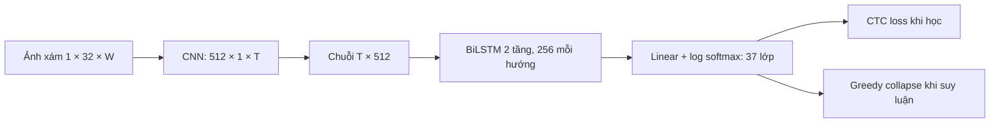

# Tìm hiểu CRNN kết hợp CNN–BiLSTM–CTC và nhận dạng từ trên IIIT5K

Báo cáo thực nghiệm ngày 07/10/2026. Nội dung được tạo từ cấu hình, dự đoán và phân tích đã lưu; không dùng số liệu của kiểm tra smoke. Thông tin sinh viên, lớp và giảng viên được bổ sung khi đóng quyển.

## Tóm tắt

Đề tài triển khai CRNN bằng PyTorch để nhận dạng ảnh đã cắt chứa một từ. CNN tạo chuỗi đặc trưng ngang, BiLSTM học ngữ cảnh hai phía, CTC học căn chỉnh từ nhãn chuỗi. Tập IIIT5K được chia cố định thành 1.800 train, 200 validation và 3.000 test. Baseline học từ đầu seed 42 đạt Accuracy 22,37% và micro CER 44,91%. Phiên bản cải tiến học trước trên 20.000 ảnh chữ tự sinh rồi tinh chỉnh với augmentation và regularization. Trung bình ba seed tăng Accuracy 37,52 điểm phần trăm; các kết quả từng seed được công bố đầy đủ. Run chính chọn bằng validation, seed 42, đạt 62,10% Accuracy và 18,65% CER trên test. Phân tích lỗi gồm độ dài, chỉ số Laplacian, phép sửa ký tự và chín tác động có kiểm soát. Nhãn mờ/biến dạng tự nhiên vẫn cần người gán; phần này chưa đủ dữ liệu cho kết luận theo nhãn thủ công.

## 1. Giới thiệu

Nhận dạng chữ trong biển hiệu, nhãn hàng hoặc giao diện đòi hỏi dự đoán chuỗi có số ký tự thay đổi từ ảnh. Đề tài xét vùng ảnh chứa một từ đã được cắt; mô hình chưa phát hiện vị trí chữ trong ảnh toàn cảnh. Đầu ra gồm chữ Latin và chữ số, chuẩn hóa chữ thường. IIIT5K gồm cả scene text và born-digital, vì vậy tên bộ dữ liệu không có nghĩa mọi mẫu đều là ảnh chụp cảnh tự nhiên. Nguồn: [Mishra, Alahari và Jawahar, BMVC 2012](https://www.bmva-archive.org.uk/bmvc/2012/BMVC/paper127/index.html).

Ba câu hỏi nghiên cứu là: (1) lỗi thay đổi thế nào theo độ dài nhãn; (2) chỉ số sắc nét trên ảnh gốc có liên hệ gì với lỗi và tác động mờ tạo thêm có làm giảm nhận dạng; (3) phối cảnh/chữ cong gây thay đổi gì trong phép thử theo cặp? Đề tài đóng góp bản triển khai có thể tái lập và quy trình phân tích, không đề xuất một kiến trúc CRNN mới.

## 2. Cơ sở lý thuyết

CNN học các biên và tổ hợp nét chữ. Hai pooling đầu giảm chiều rộng bốn lần; các pooling sau chỉ giảm chiều cao. Tích chập cuối `(2,1)` làm chiều cao còn 1; mỗi cột tương ứng một vector 512 chiều. Số bước hợp lệ của ảnh i là `T_i=floor(W_i/4)`. Đây là điều chỉnh của mã đề tài: bài gốc dùng kernel cuối `2×2` và khối hồi quy có phép chiếu giữa tầng. Các kết quả không phải tái lập nguyên cấu hình bài gốc. Nguồn: [Shi, Bai và Yao, arXiv 1507.05717](https://arxiv.org/abs/1507.05717).

BiLSTM ghép trạng thái theo hướng trái→phải và phải→trái, đưa ngữ cảnh hai phía vào dự đoán tại một vị trí. Mô hình dùng hai tầng, 256 đơn vị mỗi hướng. Với độ rộng ảnh khác nhau, chuỗi được đóng gói theo độ dài hợp lệ để hướng ngược không đọc vùng padding. Diễn giải đầy đủ các cổng LSTM và kích thước tensor nằm trong [cơ sở lý thuyết](co_so_ly_thuyet.md).

CTC bổ sung blank `ε`, cộng xác suất tất cả đường căn chỉnh có cùng nhãn sau phép collapse:

\[
P(y\mid I)=\sum_{\pi:\mathcal B(\pi)=y}\prod_{t=1}^T p_t(\pi_t\mid I),\qquad
\mathcal L_{CTC}=-\log P(y\mid I).
\]

Collapse gộp ký hiệu lặp liên tiếp rồi bỏ blank. Ví dụ `b b ε o o ε o k k` tạo `book`; bỏ blank trước khi gộp sẽ sai. Nhãn dài L với r cặp ký tự trùng kề nhau cần ít nhất `T ≥ L+r`; toàn bộ IIIT5K đã được audit điều kiện này. CTC dùng quy hoạch động nên không cần phân đoạn từng ký tự. Nguồn: [Graves và cộng sự, ICML 2006](https://www.cs.toronto.edu/~graves/icml_2006.pdf). Greedy chọn argmax từng bước rồi collapse; kết quả không nhất thiết là nhãn có tổng xác suất cao nhất.

## 3. Dữ liệu và phương pháp

### 3.1. Phân chia và kiểm tra IIIT5K

Archive được xác minh SHA256 `7872c9efbec457eb23f3368855e7738f72ce10927f52a382deb4966ca0ffa38e`. Train gốc 2.000 ảnh được tách thành 1.800 train và 200 validation bằng nhóm từ đã chuẩn hóa, seed chia 42; cùng nhãn nằm trong cùng phần. Test giữ đủ 3.000 ảnh. Không loại mẫu, không xóa ký tự khỏi nhãn. Bảng chữ cái `0123456789abcdefghijklmnopqrstuvwxyz`, blank chỉ số 0; tổng 37 lớp.

Audit cho thấy train–validation không trùng nhãn và ba cặp split không trùng hash ảnh. Nhãn test vẫn có thể xuất hiện trong train theo phân chia chính thức: 1261 ảnh test mang từ đã thấy và 1739 mang từ chưa thấy. Phân tích này là mô tả hậu nghiệm; không được coi một trong hai nhóm là toàn bộ benchmark. Chi tiết/hash: [split metadata](../data/manifests/split_metadata.json).

Ảnh được fit giữ tỷ lệ trong khung cao 32/rộng tối đa 320, căn giữa dọc và padding trắng phải đến tối thiểu 64, bội số 4. Do giới hạn rộng, chiều cao chữ giảm ở 4 mẫu train và 11 mẫu test. Khi ghép batch, thêm 24 pixel trắng bên phải để CNN đọc cùng nền ở rìa ảnh; sáu bước sinh thêm không được đưa vào CTC hoặc decoder. Kiểm thử đã xác minh dự đoán ảnh đơn và cùng ảnh trong batch.

### 3.2. Dữ liệu chữ tự sinh

Bộ sinh dùng font đã có trên Windows, vẽ chữ với hộp bao đủ nét, thay đổi hoa/thường, màu nền/chữ, nhiễu nền nhẹ, góc quay nhỏ và một phần phối cảnh/mờ. Có 20,000 ảnh train và 1,000 ảnh validation tổng hợp. Train lấy khoảng 40% nhãn từ IIIT5K train và 60% chuỗi chữ/số ngẫu nhiên; số thực tế được lưu trong `source_metadata.json`. Không dùng nhãn/ảnh IIIT5K validation/test hoặc lexicon kèm benchmark để tạo bộ này.

Validation tổng hợp có nhãn ngẫu nhiên không trùng nguồn từ train tổng hợp; các file font Verdana/Tahoma được giữ riêng. Có 45 file font train và 5 file validation, lưu hash từng file. Trùng nhãn giữa hai phần tổng hợp là 0. Một checkpoint học trước được dùng chung cho ba seed tinh chỉnh; biến thiên giữa seed chỉ phản ánh giai đoạn tinh chỉnh, không phản ánh nhiều lần học trước độc lập.

Động cơ sử dụng chữ tổng hợp dựa trên [Jaderberg và cộng sự, 2014](https://arxiv.org/abs/1406.2227). Bộ nhỏ trong đề tài là triển khai tự sinh độc lập, không phải Synth90k hoặc bộ 8 triệu ảnh dùng trong CRNN gốc. Ảnh này đơn giản hơn nhiều cảnh thật nên chuyển miền vẫn là giới hạn.

### 3.3. Cấu hình huấn luyện

Mô hình có 8,199,461 tham số. Baseline học từ đầu 50 epoch, batch 16, Adam learning rate 0,001, không dropout/augmentation. Học trước dùng 10 epoch, batch 32, Adam 0,001, dropout 0,1; checkpoint được chọn bằng validation tổng hợp. Cấu hình tinh chỉnh đã cố định trước các lần đánh giá test mới: tối đa 50 epoch, batch 16, AdamW learning rate 0,0003, weight decay 0,0001, dropout 0,2, augmentation nhẹ chỉ trên train. Dropout nằm sau đặc trưng CNN và giữa hai tầng BiLSTM; không thay số tham số hoặc trạng thái trọng số cũ.

Augmentation gồm contrast 0,85–1,15; blur xác suất 25%, radius 0,2–0,7; noise xác suất 35%, độ lệch chuẩn 1–4 mức pixel; rotation xác suất 35%, ±3° và mở rộng canvas. Nếu augmentation làm thiếu bước CTC thì dùng ảnh gốc; ảnh gốc không khả thi vẫn bị từ chối. Run chính có 0 lần fallback. Validation/test không dùng augmentation huấn luyện.

ReduceLROnPlateau theo validation loss, factor 0,5, patience 5, min LR 0,00001. Early stopping sau 12 epoch không cải thiện quy tắc chọn checkpoint. Quy tắc chọn là validation Word Accuracy cao nhất, hòa thì loss thấp nhất. Run chính chạy 33 epoch, chọn epoch 21, lý do kết thúc `early_stopping`; thời gian train/validation cộng từ history 284,69 giây. Mỗi fine-tune tạo optimizer mới và chỉ nạp trọng số tương thích; không tái dùng optimizer của học trước.

Môi trường thực chạy: Windows-11-10.0.26200-SP0, Python 3.12.3, PyTorch 2.5.1+cu121, CUDA runtime 12.1, NVIDIA GeForce RTX 3050 Laptop GPU 4 GB. Precision float32, gradient clipping 5, seed/thuật toán quyết định được bật. CNN/BiLSTM chạy GPU; CTC loss trên CPU bằng phép chuyển tensor giữ gradient vì CUDA CTC backward không hỗ trợ chế độ quyết định của cấu hình này. Thời gian đo bao gồm chi phí truyền GPU–CPU.

Baseline test seed 42 đã được xem trước khi đề xuất cải tiến. Vì vậy chuỗi thí nghiệm tiếp theo là cải tiến có tính khám phá; không tuyên bố test hoàn toàn chưa được quan sát. Công thức được đóng băng ở [experiment plan](../runs/experiment_plan.json) trước lần test bổ sung. Không chọn seed hoặc đổi công thức bằng test. Đây là so sánh nhiều thay đổi đồng thời; chưa có ablation tách tác dụng riêng của dữ liệu tổng hợp, dropout, augmentation và optimizer.

### 3.4. Đánh giá và phân nhóm

Word Accuracy là tỷ lệ dự đoán đúng toàn từ. Micro CER là tổng khoảng cách Levenshtein chia tổng ký tự nhãn; không phải trung bình CER từng ảnh. Khoảng Wilson 95% áp dụng cho Accuracy theo ảnh. Mean ± sample SD mô tả ba seed trên cùng split và không thay thế khoảng theo ảnh. Bootstrap so sánh theo cặp lấy lại cùng ID ảnh 2.000 lần seed 42; khoảng delta chỉ mô tả mẫu ảnh của hai checkpoint cụ thể.

Nhóm độ dài là 1–3, 4–6, 7–9, từ 10 ký tự. Chỉ số sắc nét là variance Laplacian bốn lân cận trên ảnh xám scale pixel 0–255, resize cao 64 giữ tỷ lệ, không padding; ngưỡng train là 195,8705 và 684,3447. Đây là proxy, không phải nhãn mờ chuẩn. Công cụ gán nhãn ảnh gốc cung cấp `clear/moderate/severe` và `none/perspective/curved/stylized/mixed`; ô trống là chưa gán.

## 4. Kết quả và phân tích

### 4.1. Học trước và quá trình tinh chỉnh

Học trước chọn epoch 10, validation tổng hợp Accuracy 94,70%. Kiểm tra chuyển miền trên 200 ảnh validation IIIT5K trước fine-tune đạt Accuracy 53,50% và CER 20,37%. Đây là validation, không phải số liệu test của mô hình học trước.

Baseline seed 42 đã đạt 100% Accuracy khi đánh giá lại train nhưng test chỉ 22,37%; khoảng cách này phù hợp với overfit. Phiên bản cải tiến dùng thêm dữ liệu và regularization; hiệu quả được đọc ở test và nhiều seed dưới đây, không suy từ train accuracy đơn lẻ.

### 4.2. Tổng thể và biến thiên seed

| Công thức | Seed | Epoch chọn | Val Acc (%) | Test đúng/3.000 | Test Acc (%) | Wilson 95% (%) | Micro CER (%) |
|---|---|---|---|---|---|---|---|
| baseline | 7 | 38 | 26,00 | 676/3000 | 22,53 | 21,07–24,06 | 44,14 |
| baseline | 42 | 47 | 28,50 | 671/3000 | 22,37 | 20,91–23,89 | 44,91 |
| baseline | 123 | 40 | 37,50 | 771/3000 | 25,70 | 24,17–27,29 | 41,42 |
| improved | 7 | 12 | 82,50 | 1809/3000 | 60,30 | 58,54–62,04 | 19,44 |
| improved | 42 | 21 | 83,50 | 1863/3000 | 62,10 | 60,35–63,82 | 18,65 |
| improved | 123 | 13 | 83,00 | 1823/3000 | 60,77 | 59,01–62,50 | 19,71 |

| Công thức | Số seed | Accuracy trung bình ± SD (%) | CER trung bình ± SD (%) |
|---|---|---|---|
| baseline | 3 | 23,53 ± 1,88 | 43,49 ± 1,84 |
| improved | 3 | 61,06 ± 0,93 | 19,27 ± 0,55 |

| Seed | Delta Acc (điểm %) | Bootstrap theo ảnh 95% | Sai → đúng | Đúng → sai |
|---|---|---|---|---|
| 7 | 37,77 | 35,87–39,57 | 1196 | 63 |
| 42 | 39,73 | 37,87–41,53 | 1232 | 40 |
| 123 | 35,07 | 33,20–36,97 | 1107 | 55 |

Delta ở đây là cải tiến trừ baseline cùng seed. Seed là thao tác ngẫu nhiên khác nhau trên cùng split, không tạo các tập test độc lập. Cả ba run cải tiến chia sẻ checkpoint học trước. Run chính seed 42 được chọn bằng validation Accuracy 83,50% và loss 0,2825; không chọn bằng kết quả test. So baseline seed 42 ở các bảng nhóm dưới nhằm giữ đường tham chiếu ban đầu; so sánh cùng seed được báo ở bảng theo cặp phía trên.

### 4.3. Độ dài từ

| Độ dài | N | Baseline 42 Acc (%) | Cải tiến chính Acc (%) | Wilson 95% | Baseline CER (%) | Cải tiến CER (%) |
|---|---|---|---|---|---|---|
| 1-3 | 866 | 37,64 | 76,21 | 73,26–78,93 | 43,75 | 15,10 |
| 4-6 | 1355 | 21,03 | 61,33 | 58,71–63,89 | 43,17 | 18,56 |
| 7-9 | 623 | 8,83 | 46,55 | 42,67–50,47 | 47,22 | 22,08 |
| >=10 | 156 | 3,21 | 52,56 | 44,76–60,24 | 46,38 | 14,05 |

Word Accuracy yêu cầu đúng toàn bộ chuỗi nên từ dài có nhiều cơ hội sai. Cần đọc CER cùng Accuracy: tăng lỗi toàn từ không tương đương tăng lỗi trên mỗi ký tự cùng mức. Nhóm từ 10 ký tự chỉ có 156 ảnh; khoảng Wilson thể hiện bất định lớn hơn. Tất cả nhãn đều khả thi CTC, vì vậy lỗi từ dài không được quy trực tiếp cho việc không tồn tại đường căn chỉnh.

### 4.4. Chỉ số sắc nét trên ảnh gốc

| Chỉ số sắc nét | N | Accuracy (%) | Wilson 95% (%) | Micro CER (%) |
|---|---|---|---|---|
| low_sharpness | 917 | 68,81 | 65,74–71,73 | 12,23 |
| medium_sharpness | 879 | 68,83 | 65,69–71,80 | 13,68 |
| high_sharpness | 1204 | 52,08 | 49,25–54,89 | 26,92 |

Trên baseline, nhóm chỉ số sắc nét cao có Accuracy thấp hơn nhóm thấp. Kết quả này không hỗ trợ suy luận “proxy thấp luôn gây lỗi cao”. Laplacian còn phản ánh tương phản, nền và nét chữ, trong khi độ dài/nguồn ảnh khác nhau giữa nhóm. Phân tầng ảnh gốc là liên hệ quan sát; phép thử Gaussian theo cặp ở mục 4.6 giữ cùng nội dung ảnh nên trả lời một câu hỏi khác.

### 4.5. Mờ và biến dạng tự nhiên theo nhãn thủ công

Hiện có 0/3.000 nhãn mờ thủ công và 0/3.000 nhãn biến dạng. Vì chưa có nhãn người gán, không lập bảng Accuracy theo `none/perspective/curved/stylized/mixed` và không coi ô trống là `none`. Một mẫu ngẫu nhiên 200 ảnh, seed 42, đã được xuất trong [công cụ offline](../data/annotation_tool/index.html), chọn độc lập với dự đoán. Có lưu ghi chú và import CSV kiểm tra ID, giá trị, xung đột. Hướng dẫn: [gán nhãn](gan_nhan.md).

Phần thực nghiệm theo nhãn tự nhiên còn cần người xem ảnh, rà tiêu chí và có thể một người thứ hai gán độc lập để đo bất đồng. Không suy nhãn chuẩn từ Laplacian hoặc tỷ lệ khung hình. Sau import, chạy lại phân tích sẽ báo coverage, strata thủ công và đối chiếu proxy tự động.

### 4.6. Độ bền với tác động có kiểm soát

Gaussian radius 0,7/1,2/2,0 pixel trên ảnh gốc. Perspective và wave dùng toàn canvas với tham số chính xác lưu ở [corruption specification](../src/crnn/distortions.py) và metadata từng mức; không cắt bỏ ký tự để tạo nhãn mới. Chín điều kiện dùng cùng 3.000 ID và cùng checkpoint chính, không gộp thành 27.000 ảnh độc lập. Accuracy clean của run chính là 62,10%.

| Tác động | Mức | Baseline 42 Acc (%) | Cải tiến Acc (%) | Cải tiến CER (%) | Delta so clean (điểm %) | Bootstrap delta 95% |
|---|---|---|---|---|---|---|
| gaussian_blur | 1 | 21,27 | 59,53 | 19,89 | -2,57 | -3,57–-1,60 |
| gaussian_blur | 2 | 14,77 | 43,60 | 34,54 | -18,50 | -20,03–-16,93 |
| gaussian_blur | 3 | 8,13 | 25,17 | 56,67 | -36,93 | -38,77–-35,10 |
| perspective | 1 | 17,37 | 58,70 | 21,04 | -3,40 | -4,63–-2,20 |
| perspective | 2 | 9,63 | 48,20 | 28,08 | -13,90 | -15,53–-12,40 |
| perspective | 3 | 5,07 | 30,20 | 44,24 | -31,90 | -33,73–-30,17 |
| wave | 1 | 15,93 | 58,07 | 20,67 | -4,03 | -5,27–-2,87 |
| wave | 2 | 11,77 | 49,03 | 25,12 | -13,07 | -14,47–-11,60 |
| wave | 3 | 7,17 | 36,47 | 32,00 | -25,63 | -27,47–-23,97 |

Delta là Accuracy tác động trừ clean; dấu âm biểu thị giảm. Khoảng bootstrap khác Wilson từng điều kiện. Tác động nhân tạo có tham số biết trước hỗ trợ đánh giá độ nhạy của checkpoint cụ thể, nhưng không đại diện đầy đủ chữ cong/phối cảnh tự nhiên hoặc mức mờ cảm nhận của người đọc.

### 4.7. Phép sửa ký tự và các nhóm bổ sung

| Phép sửa | Baseline 42 | Cải tiến chính |
|---|---|---|
| substitution | 4709 | 1798 |
| deletion | 1886 | 831 |
| insertion | 263 | 219 |

| Nhóm quan sát | N | Baseline Acc (%) | Cải tiến Acc (%) | Cải tiến CER (%) |
|---|---|---|---|---|
| adjacent_repeat | 448 | 12,28 | 54,91 | 18,64 |
| no_adjacent_repeat | 2552 | 24,14 | 63,36 | 18,65 |
| width_limited | 11 | 0,00 | 54,55 | 15,47 |
| not_width_limited | 2989 | 22,45 | 62,13 | 18,69 |
| seen_word | 1261 | 38,07 | 70,18 | 14,86 |
| unseen_word | 1739 | 10,98 | 56,24 | 20,64 |

Phân bổ phép sửa lấy từ một đường Levenshtein tối ưu, quy tắc tie-break cố định; các đường tối ưu khác có thể phân bổ loại edit khác nhau. Lỗi xóa không tự chứng minh CTC là nguyên nhân. Nhóm có chữ lặp, từ chưa thấy và ảnh bị giới hạn rộng khác nhau về nội dung/độ dài; bảng là mô tả, chưa phải tác động nhân quả. Chỉ 11 ảnh test bị giảm cao để vừa rộng nên cần tránh kết luận mạnh từ nhóm này.

### 4.8. Ví dụ lỗi thật

| ID | Nhãn | Dự đoán | Edit distance |
|---|---|---|---|
| test/2005_2.png | sturgeon | rrrkerrkgrekkkk | 12 |
| test/406_3.png | grassrootsmarketing | eraeeeootenaarkectma | 11 |
| test/898_1.png | wwwnonstopsignscom | roreinbrstopsigoneco | 10 |
| test/2524_7.png | shoestring | 2 | 10 |
| test/429_1.png | fashionistas | beiometke | 9 |
| test/114_10.png | atmosphere | reucwwe | 9 |
| test/2086_2.png | residencia | kzkaka | 9 |
| test/1026_3.png | platinum | carcrkkis | 9 |

Chọn ví dụ bằng edit distance giảm dần, sau đó độ dài nhãn giảm dần và ID, tối đa 12 ảnh đọc được; quy tắc không dựa vào một nguyên nhân muốn minh họa. Nhãn, dự đoán và ảnh gốc cho phép người đọc kiểm tra. Giải thích riêng từng lỗi cần quan sát nét chữ; từ vài ví dụ không thể kết luận một cơ chế duy nhất cho toàn bộ nhóm.

## 5. Kết luận và hướng phát triển

Đề tài đã hoàn thành chuỗi xử lý CNN–BiLSTM–CTC, huấn luyện/đánh giá IIIT5K, học trước với nguồn dữ liệu rõ, so sánh ba seed và phân tích lỗi có đầu ra kiểm tra được. Trung bình Accuracy cải tiến thay đổi 37,52 điểm phần trăm so baseline, theo công thức nhiều yếu tố đã đóng băng. Kết quả theo độ dài và CER cần được đọc đồng thời; chỉ số Laplacian không được thay thế trực tiếp nhãn mờ. Các tác động có kiểm soát cho thấy độ nhạy theo mức với từng checkpoint.

Giới hạn chính là bộ train thật nhỏ, bộ chữ tổng hợp chưa giống đầy đủ cảnh thật, chỉ một khởi tạo học trước, ba seed mô tả, bảng ký tự hạn chế và chưa có nhãn mờ/biến dạng người gán. Test baseline đã được quan sát nên phần cải tiến có tính khám phá. Số liệu bài CRNN gốc dùng lượng dữ liệu/decoder khác không phải đối chứng công bằng cho cấu hình này.

Ưu tiên tiếp theo là hoàn tất mẫu gán nhãn và kiểm tra bất đồng, rồi làm ablation tiền huấn luyện/augmentation/dropout từng yếu tố. Những mở rộng dựa trên lỗi gồm nền tổng hợp đa dạng hơn, khối chỉnh hình cho chữ cong/phối cảnh và giải mã beam search công bố rõ lexicon. Mức cải thiện của các mở rộng chưa thực hiện không được khẳng định trước.

## Phụ lục: tái lập và nguồn kết quả

- Kế hoạch cố định: [experiment_plan.json](../runs/experiment_plan.json); nội dung lý do: [kế hoạch hoàn thiện](ke_hoach_hoan_thien.md).
- Tạo chữ tổng hợp và chạy các thí nghiệm: `python -m crnn.synthetic`, `python scripts/run_extended.py --device cuda`; các thư mục hoàn tất được bảo vệ khỏi ghi đè. `--resume` chỉ bỏ qua stage đã hoàn tất; không phục hồi optimizer giữa epoch bị ngắt.
- So sánh: [comparison.md](../runs/comparison/comparison.md), [comparison.json](../runs/comparison/comparison.json), bảng từng seed và bootstrap trong cùng thư mục.
- Run chính: `runs/improved_seed42`, checkpoint SHA256 `e6f2e8f076ca171dfe5e1493a143e8c41a0517b6f870c0536be0aa9def165c91`; [phân tích đầy đủ](../runs/improved_seed42/analysis/report.md).
- Cấu hình/history/environment/source hash được lưu trong từng thư mục run; file metadata các hình lưu hash nguồn dữ liệu.
- Báo cáo này được sinh bởi `scripts/write_final_report.py`; các bảng không nhập tay. Dataset và checkpoint là artifact nghiên cứu cục bộ, không đóng gói cùng mã.
- Tài liệu tham khảo đầy đủ: [BibTeX](tai_lieu_tham_khao.bib). Lý thuyết và giao thức chi tiết: [cơ sở lý thuyết](co_so_ly_thuyet.md), [thiết kế thực nghiệm](thiet_ke_thuc_nghiem.md).
