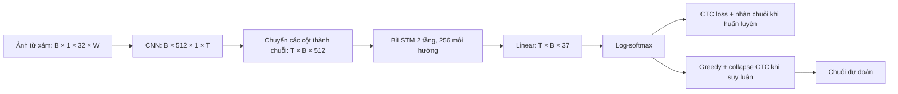

# Cơ sở lý thuyết: CRNN với CNN–BiLSTM–CTC

## 1. Nhận dạng ảnh từ như dự đoán chuỗi

Một mẫu gồm ảnh từ \(I\) và nhãn \(y=(y_1,\ldots,y_L)\). Số ký tự \(L\) thay đổi giữa các ảnh. Mục tiêu là học ánh xạ \(f_\theta:I\mapsto\hat y\) mà không yêu cầu tọa độ từng ký tự.

Phương án dùng mỗi từ làm một lớp có số lớp lớn và không thuận tiện cho chuỗi chưa xuất hiện. Phương án cắt rồi phân loại từng ký tự phụ thuộc chất lượng phân đoạn. Đề tài dùng chuỗi đặc trưng ngang và CTC để học từ nhãn cả từ. Mô hình chỉ nhận vùng chữ đã cắt; việc tìm vùng chữ trong ảnh toàn cảnh thuộc bài toán phát hiện chữ.

CRNN gốc ghép ba phần: đặc trưng tích chập, mô hình chuỗi hồi quy và phiên âm chuỗi. Đề tài dùng cấu trúc tương ứng trong PyTorch, với một số điều chỉnh được công bố dưới đây. Nguồn: [Shi, Bai và Yao, 2015](https://arxiv.org/abs/1507.05717).



Ở đây \(B\) là số ảnh trong batch, \(W\) là chiều rộng tensor sau ghép batch và \(T\) là số bước CNN tương ứng, gồm cả bước đệm. Mỗi ảnh có độ dài hợp lệ \(T_i\) riêng; không giải mã các bước padding. Chiều rộng hợp lệ \(W_i\) không bao gồm phần đệm bổ sung dùng khi ghép batch.

## 2. CNN và phép chuyển ảnh thành chuỗi

Một bộ lọc CNN học các đặc trưng cục bộ như biên, nét và cấu trúc hình dạng. Xét tích chập hai chiều:

\[
F_{o,u,v}=\phi\!\left(b_o+\sum_c\sum_{a,b}
K_{o,c,a,b}\,X_{c,u+a,v+b}\right).
\]

Các tầng sau kết hợp vùng ảnh rộng hơn. CNN giảm chiều cao còn 1 nhưng giữ nhiều vị trí ngang; mỗi cột đặc trưng trở thành một vector \(x_t\in\mathbb{R}^{512}\). Một cột có thể nhìn thấy phần của nhiều ký tự do receptive field; không có quy tắc một cột bằng một ký tự.

Kích thước một chiều của phép tích chập/pooling được tính bằng:

\[
n_{out}=\left\lfloor\frac{n_{in}+2p-d(k-1)-1}{s}+1\right\rfloor.
\]

Với cấu hình đề tài, hai pooling đầu giảm chiều rộng theo hệ số 2 mỗi lần; các pooling tiếp theo chỉ giảm chiều cao. Tầng cuối dùng kernel `(2, 1)` không giảm chiều rộng, nên:

\[
T_i=\lfloor W_i/4\rfloor.
\]

| Bước triển khai | Kênh đầu ra | Chiều cao | Chiều rộng |
|---|---:|---:|---:|
| Ảnh đầu vào | 1 | 32 | \(W\) |
| Conv 3×3 + pooling 2×2 | 64 | 16 | \(\lfloor W/2\rfloor\) |
| Conv 3×3 + pooling 2×2 | 128 | 8 | \(\lfloor W/4\rfloor\) |
| Hai Conv 3×3 + pooling (2,1) | 256 | 4 | \(T\) |
| Hai Conv 3×3 + pooling (2,1) | 512 | 2 | \(T\) |
| Conv (2,1) | 512 | 1 | \(T\) |
| Đổi trục, bỏ chiều cao 1 | 512 đặc trưng/bước | — | \(T\) bước |

ReLU được dùng sau tích chập; cấu hình có BatchNorm ở phần CNN sâu. Bảng này mô tả thiết kế của mã đề tài. Kernel cuối `(2,1)` là điều chỉnh của triển khai, khác kernel `2×2` trong bảng kiến trúc bài gốc. Do đó cần đọc kích thước từ cấu hình/mã hiện hành, không sao chép công thức thời gian từ một thư viện CRNN khác.

## 3. LSTM và BiLSTM

LSTM dùng trạng thái ô nhớ \(c_t\) và trạng thái ẩn \(h_t\). Dạng có cổng quên được dùng trong PyTorch có thể viết:

\[
\begin{aligned}
i_t &= \sigma(W_i x_t+U_i h_{t-1}+b_i),\\
f_t &= \sigma(W_f x_t+U_f h_{t-1}+b_f),\\
o_t &= \sigma(W_o x_t+U_o h_{t-1}+b_o),\\
g_t &= \tanh(W_g x_t+U_g h_{t-1}+b_g),\\
c_t &= f_t\odot c_{t-1}+i_t\odot g_t,\\
h_t &= o_t\odot\tanh(c_t).
\end{aligned}
\]

Cổng \(i_t\) điều khiển thông tin ghi vào, \(f_t\) điều khiển phần bộ nhớ giữ lại và \(o_t\) điều khiển đầu ra. \(\sigma\) là sigmoid, \(\odot\) là nhân từng phần tử. Cấu trúc trạng thái này hỗ trợ học phụ thuộc qua nhiều bước. Tham khảo nền tảng ở [Hochreiter và Schmidhuber, 1997](https://www.bioinf.jku.at/publications/older/2604.pdf); công thức đúng với biến thể triển khai xem [tài liệu LSTM chính thức của PyTorch](https://docs.pytorch.org/docs/stable/generated/torch.nn.LSTM.html?highlight=rnn).

BiLSTM có một LSTM đi từ trái sang phải và một LSTM đi từ phải sang trái:

\[
h_t=[\overrightarrow h_t;\overleftarrow h_t].
\]

Nhờ đó đặc trưng ở vị trí \(t\) có ngữ cảnh hai phía. Đây là phép xử lý không trực tuyến: cần toàn bộ ảnh từ trước khi chạy hướng ngược. Đề tài dùng hai tầng BiLSTM, hidden size 256 mỗi hướng, nên đầu ra mỗi bước có 512 chiều. Nguyên tắc hai hướng được mô tả trong [Graves và Schmidhuber, 2005](https://www.cs.toronto.edu/~graves/nn_2005.pdf).

Ảnh được fit giữ tỷ lệ vào giới hạn cao 32/rộng 320, căn giữa theo chiều dọc và padding bên phải để đạt chiều rộng tối thiểu 64, bội số 4. Với từ rất dài, chữ thực tế có thể thấp hơn 32 do giới hạn chiều rộng. Ảnh có độ rộng khác nhau được padding phải tiếp để ghép batch; sau chiều rộng lớn nhất của batch thêm **24 pixel trắng**. Biên bổ sung này giúp vùng tiếp nhận CNN ở các bước hợp lệ đọc cùng nền trắng, thay vì thay đổi theo việc ảnh đứng một mình hay nằm trong batch rộng hơn.

Độ rộng hợp lệ \(W_i\) và \(T_i=\lfloor W_i/4\rfloor\) vẫn giữ nguyên. Phần đệm 24 pixel làm CNN có thêm sáu bước nhưng không tăng số bước được phép dùng để căn chỉnh target. Chuỗi được đóng gói theo \(T_i\) trước BiLSTM và decoder chỉ đọc \(T_i\) bước; mọi phần đuôi đệm bị bỏ qua. Cần dùng cùng cách ghép batch ở train, validation, test và suy luận.

## 4. CTC: từ phân bố theo bước đến nhãn từ

CTC bổ sung ký hiệu blank \(\epsilon\) vào bảng ký tự \(\mathcal A\). Trong đề tài blank có chỉ số 0, các ký tự thật có chỉ số 1 đến 36. Blank biểu thị không phát ra ký tự; không phải dấu cách trong nhãn.

Một đường căn chỉnh \(\pi=(\pi_1,\ldots,\pi_T)\) thuộc \((\mathcal A\cup\{\epsilon\})^T\). Phép \(\mathcal B\) gộp các ký hiệu giống nhau liên tiếp, rồi bỏ blank. Ví dụ tự xây dựng:

```text
Đường:        B B ε O O ε O K K
Gộp lặp:      B   ε O   ε O K
Bỏ blank:     B     O     O K   → BOOK
```

Nếu đường chỉ là `B B O O K K`, kết quả là `BOK`, vì hai `O` liên tiếp bị gộp. Blank giữa hai `O` giữ chúng thành hai ký tự. Thứ tự gộp rồi bỏ blank quyết định tính đúng của decoder.

Với \(p_t(k\mid I)\) là xác suất ký hiệu \(k\) tại bước \(t\):

\[
P(\pi\mid I)=\prod_{t=1}^T p_t(\pi_t\mid I),\qquad
P(y\mid I)=\sum_{\pi:\mathcal B(\pi)=y}P(\pi\mid I),
\]

\[
\mathcal L_{CTC}(I,y)=-\log P(y\mid I).
\]

CTC cộng xác suất của mọi đường hợp lệ; dùng quy hoạch động forward–backward để tính mà không liệt kê từng đường. Nguồn định nghĩa: [Graves và cộng sự, ICML 2006, mục 3–4](https://www.cs.toronto.edu/~graves/icml_2006.pdf).

Có thể chèn blank vào đầu, cuối và giữa các ký tự để tạo \(y'\) dài \(2L+1\). Gọi \(\alpha_t(s)\) là tổng xác suất các đường đến vị trí \(s\) của \(y'\) tại bước \(t\). Quy tắc chuyển gồm giữ nguyên vị trí, đi một vị trí, hoặc đi hai vị trí nếu không vượt qua blank cần thiết giữa hai ký tự trùng:

\[
\alpha_t(s)=p_t(y'_s\mid I)\left[
\alpha_{t-1}(s)+\alpha_{t-1}(s-1)+
\mathbf1[s>2\ \land\ y'_s\ne\epsilon\ \land\ y'_s\ne y'_{s-2}]
\alpha_{t-1}(s-2)\right].
\]

Trạng thái ngoài biên có giá trị 0; bước đầu khởi tạo ở blank đầu hoặc ký tự đầu. Cuối chuỗi:

\[
P(y\mid I)=\alpha_T(2L+1)+\alpha_T(2L).
\]

Số trạng thái được cập nhật tỉ lệ \(T\times L\). Triển khai thư viện tính trong miền log để ổn định số; phép tích theo bước không khiến BiLSTM mất ngữ cảnh vì mỗi \(p_t\) đã phụ thuộc ảnh thông qua chuỗi đặc trưng hai chiều.

### 4.1. Điều kiện độ dài khả thi

Gọi \(L=|y|\), \(r=\sum_{j=2}^{L}\mathbf 1[y_j=y_{j-1}]\). Từ quy tắc collapse suy ra số bước tối thiểu:

\[
T\ge L+r.
\]

Mỗi ký tự cần ít nhất một bước; mỗi cặp ký tự trùng kề nhau cần thêm một blank ngăn cách. Với `book`, \(L=4,r=1\), nên cần ít nhất 5 bước, ví dụ `b o ε o k`. Điều kiện \(T\ge L\) đơn thuần là chưa đủ.

Đây là điều kiện toán học để tồn tại đường hợp lệ, không bảo đảm CNN còn đủ chi tiết ảnh hay mô hình nhận dạng đúng. Trước huấn luyện cần audit cả \(T_i\) và nhãn. Nếu mẫu không đủ bước, phải điều chỉnh cấu hình hoặc công bố loại mẫu; không giấu mẫu bằng cách cho loss về 0. `CTCLoss` nhận log-probability dạng `(T, B, C)` và các độ dài hợp lệ; tùy chọn `zero_infinity` có thể đặt loss vô hạn về 0. Nguồn API: [PyTorch CTCLoss](https://docs.pytorch.org/docs/stable/generated/torch.nn.modules.loss.CTCLoss.html).

Trong mã đề tài, `reduction="mean"` của PyTorch chia loss từng mẫu cho độ dài target rồi lấy trung bình batch:

\[
\mathcal L_{batch}=\frac1B\sum_{i=1}^{B}
\frac{-\log P(y_i\mid I_i)}{L_i}.
\]

Loss được lưu mỗi epoch là trung bình theo số mẫu của đại lượng này, khác tổng negative log-likelihood chưa chuẩn hóa. CNN/BiLSTM chạy trên thiết bị được chọn, còn CTC loss chạy trên CPU qua phép chuyển log-probability không tách gradient. Gradient vẫn truyền về mô hình. Lựa chọn này hỗ trợ chế độ thuật toán quyết định của lần huấn luyện; cần ghi `ctc_loss_device=cpu` trong cấu hình và chấp nhận chi phí chuyển dữ liệu GPU–CPU khi đo thời gian.

### 4.2. Giải mã greedy

\[
\pi_t^*=\operatorname*{argmax}_k p_t(k\mid I),\qquad
\hat y=\mathcal B(\pi^*).
\]

Greedy chọn đường có xác suất lớn nhất theo bước, nhưng không bảo đảm nhãn sau collapse có tổng xác suất lớn nhất. Nhiều đường khác nhau có thể cùng quy về một nhãn. Beam search có thể là mở rộng về sau; baseline thống nhất dùng greedy không từ điển và không sửa từ bằng nhãn test.

## 5. Chuẩn hóa nhãn và đánh giá

Nhãn và dự đoán được chuyển thành chữ thường, với bảng ký tự đã cố định. Ký tự ngoài bảng phải được audit theo chính sách dữ liệu; không âm thầm xóa ký tự để làm điểm số cao hơn. Không đánh đồng việc nhận dạng chữ không phân biệt hoa/thường với nhận dạng đầy đủ mọi ký hiệu.

Với \(N\) ảnh, Word Accuracy đo số từ đúng hoàn toàn:

\[
\operatorname{Acc}_{word}=\frac1N\sum_{i=1}^{N}\mathbf 1[\hat y_i=y_i].
\]

Micro CER cộng khoảng cách chỉnh sửa Levenshtein trên toàn tập, rồi chia tổng số ký tự nhãn:

\[
\operatorname{CER}_{micro}=\frac{\sum_i d(\hat y_i,y_i)}{\sum_i |y_i|}.
\]

Khoảng cách \(d\) là số phép thêm, xóa hoặc thay ký tự tối thiểu. Micro CER khác trung bình CER từng từ: từ dài đóng góp nhiều hơn vào mẫu số micro. CER có thể lớn hơn 1 nếu có nhiều ký tự thêm; không cắt giá trị ở 100%. Ví dụ tự xây dựng: dự đoán `boook` cho `book` có một phép thêm, CER của mẫu là \(1/4\), nhưng Word Accuracy của mẫu là 0.

Độ dài cao tạo nhiều cơ hội sai toàn từ. Vì vậy cần đọc đồng thời Word Accuracy, CER và số mẫu trong từng nhóm, không chỉ so một cột phần trăm.

## 6. Cách nối lý thuyết với phân tích lỗi

- **Độ dài:** kiểm tra từ dài, mức thu nhỏ để vừa giới hạn rộng và khoảng cách giữa \(T_i\) với \(L_i+r_i\). Từ dài có thể khó vì nhiều ký tự hoặc vì mất chi tiết khi thu nhỏ; cần phân biệt bằng ví dụ và thống kê.
- **Mờ:** mất biên có thể làm CNN khó phân biệt các nét gần nhau. Phương sai Laplacian chỉ là chỉ số sắc nét thay thế, chịu ảnh hưởng của nền, tương phản và nhiễu.
- **Biến dạng:** chuỗi cột ngang giả định thứ tự đọc chủ yếu từ trái sang phải. Chữ cong, phối cảnh và nét cách điệu có thể làm đặc trưng khó đọc hơn. Giả thuyết này phải được kiểm chứng.
- **CTC:** xem lỗi thêm/xóa/thay và các chữ lặp. Nhiều lỗi xóa không tự chứng minh CTC là nguyên nhân; cần kiểm tra đầu ra và độ dài hợp lệ.

## 7. Tài liệu đọc chính

| Chủ đề | Nguồn sơ cấp |
|---|---|
| CRNN | [Shi, Bai và Yao, arXiv 1507.05717](https://arxiv.org/abs/1507.05717) |
| IIIT5K | [Mishra, Alahari và Jawahar, BMVC 2012](https://www.bmva-archive.org.uk/bmvc/2012/BMVC/paper127/index.html) |
| LSTM | [Hochreiter và Schmidhuber, 1997](https://www.bioinf.jku.at/publications/older/2604.pdf) |
| BiLSTM | [Graves và Schmidhuber, 2005](https://www.cs.toronto.edu/~graves/nn_2005.pdf) |
| CTC | [Graves và cộng sự, 2006](https://www.cs.toronto.edu/~graves/icml_2006.pdf) |

Chi tiết giao thức phân chia, phân nhóm và độ bền được quy định trong [thiết kế thực nghiệm](thiet_ke_thuc_nghiem.md).
